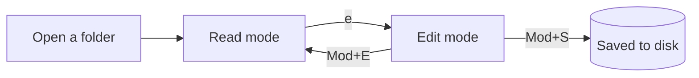
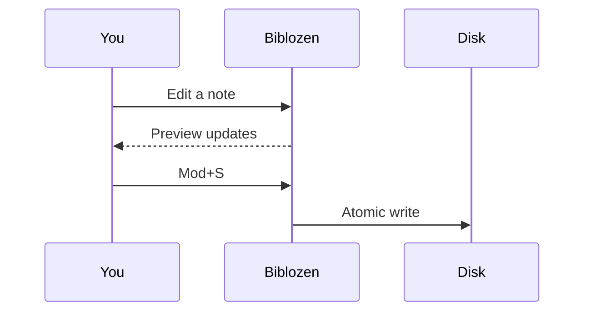

# Rendering tour

Everything on this page is plain Markdown. Switch to edit mode (<kbd>e</kbd>) to see the source side by side.

## Text

Paragraphs flow at a comfortable measure. You get **bold**, *italic*, ***both***, ~~strikethrough~~, `inline code`, <kbd>keys</kbd>, <mark>highlights</mark>, H<sub>2</sub>O and E = mc<sup>2</sup>. Bare URLs like https://example.com link automatically.

### Lists

- Unordered lists
  - nest as deep as you like
    - with tidy markers
- Mixed with *inline* formatting

1. Ordered lists
2. keep their numbers
   1. even nested ones

### Task lists

Click a checkbox — the change is saved straight to the file.

- [x] Open a folder
- [x] Read something
- [ ] Try a different theme with <kbd>t</kbd>
- [ ] Write a note of your own

## Alerts

> [!NOTE]
> Useful information that users should know, even when skimming.

> [!TIP]
> Helpful advice for doing things better or more easily.

> [!IMPORTANT]
> Key information users need to know to achieve their goal.

> [!WARNING]
> Urgent info that needs immediate user attention to avoid problems.

> [!CAUTION]
> Advises about risks or negative outcomes of certain actions.

A plain blockquote looks like this:

> Reading is to the mind what exercise is to the body.
> — Joseph Addison

## Code

```ts
// Syntax highlighting follows your color theme.
interface Note {
  title: string;
  tags: string[];
  updated: Date;
}

export function byRecent(a: Note, b: Note): number {
  return b.updated.getTime() - a.updated.getTime();
}
```

```python
def fib(n: int) -> int:
    """Return the n-th Fibonacci number."""
    a, b = 0, 1
    for _ in range(n):
        a, b = b, a + b
    return a
```

```rust
fn main() {
    let words = ["read", "write", "repeat"];
    for (i, w) in words.iter().enumerate() {
        println!("{i}: {w}");
    }
}
```

```bash
# Hover a block to copy it
git clone https://example.com/notes.git && cd notes
```

## Tables

| Feature | Read mode | Edit mode | Notes |
| :--- | :---: | :---: | ---: |
| Preview | ✓ | ✓ | split or hidden |
| Editor | — | ✓ | CodeMirror |
| Outline | ✓ | ✓ | <kbd>o</kbd> |
| Find | ✓ | ✓ | <kbd>/</kbd> |

## Math

Inline math like $e^{i\pi} + 1 = 0$ sits in the text. Display math gets its own line:

$$
\int_{-\infty}^{\infty} e^{-x^2}\,dx = \sqrt{\pi}
$$

$$
\mathbf{A} = \begin{pmatrix} a & b \\ c & d \end{pmatrix}, \qquad \det \mathbf{A} = ad - bc
$$

Prices like $5 and $10 stay as text.

## Diagrams





## Images

Local images resolve relative to the document:


Wiki-style embeds work too: ![[sketch.svg]]

## Footnotes

Footnotes collect at the bottom of the page.[^1] You can use names, too.[^note]

[^1]: Like this one.
[^note]: Named footnotes are numbered automatically.

## Front matter

The [[Welcome]] page starts with YAML front matter. Biblozen shows it as a small collapsible card instead of raw text.

---

Back to [[Welcome]].
